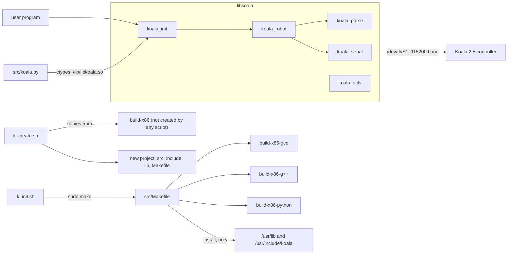

# koala2-5-manager: documentation hub

`koala2-5-manager` (`README.md:1`) is a set of files for a K-Team Koala 2.5 robot.
It has two parts. The first part is two Bash scripts. `k_init.sh` builds K-Team's
Koala library from `src/` and can install it under `/usr`. `k_create.sh` lays out a
new C or C++ project with a `Makefile`. The second part is the library itself: C code by
K-Team (2013, LGPL-2.1 or later) that drives the robot through the serial port
`/dev/ttyS1` with a one-letter ASCII protocol. A `ctypes` wrapper over it is in
`src/koala.py`. The scripts target the robot's own Linux (`docs/install.md:5`). The
repository does not say who uses them (see [SPEC.md, open questions](../SPEC.md#9-open-questions)).

The requirements specification reverse-engineered from the code is [`SPEC.md`](../SPEC.md).

## Status

| Item | State | Source |
| --- | --- | --- |
| Documented commit | `00fee5b`, 2026-11-08 12:15:56 +0200, tagged `v1.0.0` | `git log -1`, `git tag` |
| Last change to the project's own code | `5783695`, 2026-11-08: `process_param` moved from `src/koala_robot.c` into `src/koala_parse.c`, with GoogleTest cases added | `git log -- src tests k_create.sh k_init.sh projects` |
| Code written before that | 2023-07-26 to 2023-08-04: scripts, library import, Python wrapper (`59c9a82`, 2023-08-04) | `git log` |
| History | 32 commits from 2023-07-26 | `git rev-list --count HEAD` |
| Versions | recipe `$Version = '1.0.0'`; library `KOALA_VERSION 1`, `KOALA_REVISION 1`; shared object `LIBVER="1.0"` | `recipe.ps1:13`, `src/koala.h:38-39`, `k_init.sh:6` |
| Automated tests | 11 GoogleTest cases for `process_param`, 2 pytest cases for the manual-test list | `tests/koala_parse_test.cpp`, `tests/test_manual_list.py` |
| Manual tests | list is empty | `tests/manual/tests.json` |
| CI | five Gitea Actions workflows (`runs-on: windows`). There is no `.github/workflows/`, so no CI runs on GitHub | `.gitea/workflows/*.yaml` |
| TODO / FIXME markers | none in the project's own files | search over `src/`, scripts, `projects/`, `docs/` |
| Evidently unfinished | `k_create.sh` reads `build-x86/`, which nothing in the repository creates. The generated `Makefile` does not link `libkoala`. `src/robot` is not built. The scripts have no licence (`README.md:71`). Ten exceptions to the lab requirements are listed, each with an issue number from #8 to #17 (`README.md:75`). Whether those issues are still open was not checked | see [Known limitations](#known-limitations-and-problems) |

## Layout

| Path | What it is |
| --- | --- |
| `k_create.sh` | Creates `<name>/src`, `<name>/include`, `<name>/lib`, stub sources, a header and a `Makefile`; copies `build-x86/include` and `build-x86/lib/libkoala*` into it |
| `k_init.sh` | Runs `src/Makefile` with `sudo`: uninstall, build the C, Python and C++ variants, then installs the C variant if you answer `y` |
| `projects/k_us_sensor_off.sh` | Sets `/dev/ttyS1` to 115200 baud and writes `C,0,0` twice to switch the ultrasonic sensors off |
| `projects/README/k_us_sensor_off.md` | The author's description of that script |
| `src/koala.h` | Umbrella header: includes `koala_init.h`, `koala_serial.h`, `koala_robot.h`, `koala_utils.h` |
| `src/koala_init.c/.h` | `koala_init` (options `--version`, `--debug`; opens the port; registers `koala_exit`) and `koala_exit` |
| `src/koala_serial.c/.h` | RS-232 layer: open, close, read, write, read a line with or without a 500 ms wait |
| `src/koala_robot.c/.h` | Robot command set (motors, PID, ultrasonic, accelerometer, gyroscope, magnetometer, GPS, I2C, I/O, battery, auto-monitoring), constants and data types |
| `src/koala_parse.c/.h` | `process_param`: splits a comma-separated answer into integers. It is the only part that builds without the robot's `termio.h` |
| `src/koala_utils.c/.h` | Terminal helpers (`kbhit`, raw mode, ANSI cursor moves) and `koala_timeval_diff` |
| `src/koala.py` | `ctypes` wrapper: loads `/lib/libkoala.so` and wraps each public C function except `process_param` under the same name |
| `src/Makefile` | Builds `libkoala` into `../build-<TARGET_SYSTEM>-<KOALA_LANGUAGE>/`; targets `all`, `python`, `install`, `uninstall`, `clean`, `depend`, `docs` |
| `src/Doxyfile`, `src/kteamdoxy.css` | K-Team's Doxygen settings and stylesheet |
| `src/robot` | A C fragment with no extension (motor speed, IR proximity, buzzer, LEDs, TV remote over I2C registers); not compiled |
| `CMakeLists.txt` | Desktop build of `koala_parse` and its tests only |
| `tests/koala_parse_test.cpp` | GoogleTest cases for `process_param` |
| `image/README/` | Screenshots and a robot photo used by `README.md` and `projects/README/k_us_sensor_off.md`. Three of the seven files are referenced by no document |
| `docs/install.md`, `docs/manual.md` | The author's install notes and manual |

## Architecture



- `k_init.sh` passes `TARGET_SYSTEM=x86` and `KOALA_LANGUAGE` = `gcc`, `python` or
  `g++` (`k_init.sh:4-9,27-33`). `src/Makefile:7` builds into
  `../build-${TARGET_SYSTEM}-${KOALA_LANGUAGE}`, so the outputs are `build-x86-gcc/`,
  `build-x86-python/` and `build-x86-g++/` at the repository root. `k_create.sh:40-43`
  copies from `build-x86/`. Nothing in the repository creates that directory.
- Protocol. Each command writes one line: a command character, then comma-separated
  decimal arguments, then `\r`. Examples are `D,<left>,<right>\r` and `G\r`
  (`src/koala_robot.c:318,404-405`). The reply line starts with the lower-case letter
  of the command, or `@` for `&` and `!` for `?`. The fields follow from offset 2
  (`src/koala_robot.c:413,442,1091`). The full table is in
  [SPEC.md, interfaces](../SPEC.md#4-interfaces).
- Serial port: `/dev/ttyS1` at `B115200` (`src/koala_robot.h:45-46`), 8 data bits,
  receiver on, modem lines ignored, raw input and output (`src/koala_serial.c:86-92`).
  A line read waits up to 500 ms for its first byte and stops at CR or LF or after
  255 characters (`src/koala_serial.c:50,226-249`).
- External systems: the robot's microcontroller on `/dev/ttyS1`, and through its
  commands an I2C bus, a GPS receiver and four I/O ports (`src/koala_robot.h:84-108,247-256`).
  The firmware is not in this repository.

## Build and run

### On the robot's Linux

Prerequisites: Bash, GCC for C projects, G++ for C++ projects, and the robot or a Linux
with its serial port (`README.md:16-18`). `k_init.sh` also calls `sudo` and `make`.
`src/Makefile` calls `ar`, and its optional targets call `doxygen` and `makedepend`
(`src/Makefile:25,39,83`). The repository pins no versions for these.

| Step | Command | Source |
| --- | --- | --- |
| Make the scripts executable | `chmod +x k_create.sh k_init.sh` | `docs/install.md:6` |
| Build the library, optionally install it | `./k_init.sh` | `docs/install.md:7`, `README.md:46` |
| Create a project | `./k_create.sh c <name>` or `./k_create.sh cpp <name>` | `docs/install.md:8`, `README.md:34` |
| Build and run the project | `cd my_cpp_project`, `make`, `make run` | `README.md:36-40` |
| Doxygen pages of the library | `make docs` in `src/` (writes to `../doc`) | `src/Makefile:23-25`, `src/Doxyfile:41`, `docs/manual.md:13` |
| Switch the ultrasonic sensors off | `cd projects/`, `chmod +x k_us_sensor_off.sh`, `./k_us_sensor_off.sh` | `projects/README/k_us_sensor_off.md` |

`k_create.sh` must run in a directory that contains `build-x86/`
(`k_create.sh:40-43`). See [Known limitations](#known-limitations-and-problems). For a
debug build, both `src/Makefile` and the generated `Makefile` read the variable `DEBUG`
(see [Configuration](#configuration)).

### On a Windows desktop: parser tests only

Prerequisites: mingw gcc and g++ 13 or newer, CMake 3.28 or newer, Ninja, LLVM for
`clang-tidy` and `clang-format`, Python with pytest (`docs/install.md:12`,
`CMakeLists.txt:1`). GoogleTest v1.13.0 is downloaded as an archive checked by SHA-256
(`CMakeLists.txt:33-38`).

| Step | Command | Source |
| --- | --- | --- |
| Build `koala_parse` and its tests into `build\` | `.\recipe.ps1 build` | `docs/install.md:18`, `recipe.ps1:51-57,74-77` |
| Build, test, lint, format | `.\recipe.ps1 test` | `docs/install.md:14`, `recipe.ps1:110-127` |

## Configuration

The project's own code reads no environment variables. All settings are build variables
or compile-time constants.

| Name | Where | Meaning | Default |
| --- | --- | --- | --- |
| `TARGET_SYSTEM` | `src/Makefile:7`, `k_init.sh:4` | part of the build directory name | `x86` from `k_init.sh`; not set in the Makefile |
| `KOALA_LANGUAGE` | `src/Makefile:4,37,87` | compiler used, and the build directory suffix | `gcc` |
| `LIBNAME`, `LIBVER` | `src/Makefile:21,37`, `k_init.sh:5-6` | library file name `<LIBNAME>.so.<LIBVER>` | `libkoala`, `1.0` from `k_init.sh`; the Python build uses `LIBNAME=koala` (`k_init.sh:30`) |
| `DEBUG` | `src/Makefile:10-14`; generated `Makefile` (`k_create.sh:32,34`) | `1` builds with `-g`, otherwise `-O3` | unset |
| `INSTALL_PATH` | `src/Makefile:8` | install prefix | `/usr` |
| `KOALA_FLAGS` in `k_init.sh` | `k_init.sh:10` | set to `-lm` and never used | `-lm` |
| `KOALA_SERIAL_PORT_NAME`, `KOALA_SERIAL_PORT_BAUDRATE` | `src/koala_robot.h:45-46` | robot port and speed. To change them, edit the header and rebuild | `/dev/ttyS1`, `B115200` |
| `--version` / `-v` | `src/koala_init.c:47-54,88-91` | `koala_init` prints `libkoala v1.1 [<build date>]` | off |
| `--debug` / `-d` | `src/koala_init.c:47-54,85-86` | accepted and ignored. The short form expects an argument (`"d:v"`) | off |
| library path in Python | `src/koala.py:8` | shared object loaded on import | `/lib/libkoala.so` |

## Usage

1. **Prepare the robot.** Copy the repository to the robot, run `./k_init.sh`, and answer
   `y` to install the C variant. This copies `libkoala.so.1.0` into `/usr/lib`, creates
   `/usr/lib/libkoala.so`, and copies the headers into `/usr/include/koala`
   (`src/Makefile:50-59`). `libkoala.a` is not installed.
2. **Start a project.** `./k_create.sh cpp my_cpp_project` writes `src/main.cpp` (prints
   `Hello, world!`), `src/my_cpp_project.cpp`, `include/my_cpp_project.h` and a
   `Makefile` with `all`, `clean`, `depend` and `run` (`k_create.sh:17-35`). The headers
   land in `include/koala/` and the libraries in `lib/`. That happens only if
   `build-x86/` exists in the current directory.
3. **Call the library from C.** The order is `koala_init`, then commands, then `koala_exit`
   (`docs/manual.md:13`, `src/koala_init.c:72-111`). The sketch below uses only declared
   functions and constants (`src/koala_robot.h:82,233,242`). The headers install under
   `/usr/include/koala` (`src/Makefile:55-56`). The repository has no compile line for
   such a program, and this sketch was not compiled.

   ```c
   #include <koala/koala.h>

   int main(int argc, char *argv[]) {
       int us[KOALA_US_SENSORS_NUMBER];
       if (koala_init(argc, argv) < 0)       /* -1: /dev/ttyS1 did not open */
           return 1;
       if (koala_read_us_sensors(us) == 0)   /* 0 <25 cm, 25..250 cm, 1000 none, 2000 off */
           koala_set_motor_speed(10, 10);    /* pulses per 10 ms, closed loop */
       return 0;                             /* koala_exit runs from atexit */
   }
   ```

4. **Call it from Python.** `import koala` loads `/lib/libkoala.so`. The motor, battery, GPS
   and auto-mode reads return tuples, for example `rc, left, right = koala.koala_read_motor_speed()`
   (`src/koala.py:248-252`). The array, I/O, A/D and I2C wrappers instead take ctypes
   pointers from the caller (`src/koala.py:277-287,308-325`). Open the port first with `koala.koala_robot_init()`
   (`src/koala.py:168-171`). Not run.
5. **Switch the ultrasonic sensors off** without the library: `./k_us_sensor_off.sh` in
   `projects/`. `C,0,0` is the `C` command with a sensor mask of 0 and all I/O as output
   (`src/koala_robot.c:286-291`).

## Testing

- `tests/koala_parse_test.cpp`: 11 GoogleTest cases for `process_param`. They cover
  field count, the limit on the number of fields, negatives and leading spaces, a CR/LF
  line end, a non-numeric field, mixed fields such as `12abc`, runs of commas, a short
  answer, an empty answer, nine ultrasonic values, and splitting in place.
- `tests/test_manual_list.py`: 2 pytest cases that check the shape of
  `tests/manual/tests.json`. CTest runs it as `manual_list` (`CMakeLists.txt:49-53`).
- Run everything with `.\recipe.ps1 test`. It builds with CMake and Ninja, runs
  `ctest --no-tests=error`, runs `clang-tidy` over `src/koala_parse.c` and `tests/*.cpp`,
  and formats `src/koala_parse.[ch]` and `tests/*.cpp` in place. It then searches `src/`
  for lock and exception words (`recipe.ps1:110-127`).
- Not covered: the serial layer, every robot command, `koala_utils`, `koala.py`, and both
  Bash scripts. The library parts need the robot's `termio.h` and `/dev/ttyS1`
  (`CMakeLists.txt:22-23`). No test of any kind exists for them.

## Known limitations and problems

1. **The two scripts do not meet.** `k_init.sh` builds into `build-x86-gcc/`,
   `build-x86-g++/` and `build-x86-python/` (`src/Makefile:7`, `k_init.sh:4,7-9,27-33`).
   `k_create.sh` copies from `build-x86/` (`k_create.sh:40-43`), the library's output
   directory until `20c3033` (2023-08-01) added the language suffix. In a run on 2026-11-18
   in an empty temporary directory, `k_create.sh c demo` printed four `cp: cannot stat`
   errors, then `Project 'demo' created successfully!`, and exited 0. The script checks
   no exit status.
2. **The generated project does not link the library.** The link line is
   `$(CC) -o $@ $^ $(CFLAGS)` or `$(CXX) -o $@ $^ $(CXXFLAGS)` with no `-L` or `-l`
   (`k_create.sh:32,34`). The C `Makefile` adds `-I./build-x86/include`, a path that does
   not exist inside the project. The C++ `Makefile` uses `$(INCS)` without defining it.
   The generated `main` does not include any Koala header. `README.md:5,9` says the
   project "links the Koala library".
3. **The README project tree is not what the script writes.** `README.md:55` lists
   `src/project_name.h`. The script writes the header only to `include/`
   (`k_create.sh:28`), and the copied headers go to `include/koala/`.
4. **Header guard from the raw name.** `#ifndef ${project_name}_H` (`k_create.sh:28`).
   Inference: a name with `-` or `.` gives an invalid macro name.
5. **`k_us_sensor_off.sh` writes as the caller.** In `sudo echo "C,0,0\r" > /dev/ttyS1`
   (`projects/k_us_sensor_off.sh:9,13`) the calling shell opens the redirection, not
   `sudo`. `echo` without `-e` sends the two characters `\` and `r` followed by LF, not
   CR. The library ends commands with a real CR (`src/koala_robot.c:291`). Inference from
   shell semantics. The script was not run against a robot, and it is not known whether
   the firmware accepts this line.
6. **Python wrapper.**
   - It loads `/lib/libkoala.so` (`src/koala.py:8`), which is the installed C variant.
     It does not load the `build-x86-python/lib/koala.so` that `make python` builds
     (`src/Makefile:72-77`).
   - `koala_gps_data` passes `ctypes.c_void_p()`, a NULL pointer, as `date_time`
     (`src/koala.py:296,301`). The C function writes `tm_hour` through `tm_year` through
     that pointer (`src/koala_robot.c:746`). Inference: a valid `q` answer makes it write
     through NULL.
   - `koala_timeval_diff` returns `long long` (`src/koala_utils.h:59-60`), but the wrapper
     sets no `restype` (`src/koala.py:351-352`), and ctypes defaults to `int`. Inference.
   - `gps_data_t` models `struct tm` as nine `int`s (`src/koala.py:138`). Inference: glibc's
     `struct tm` also has `tm_gmtoff` and `tm_zone`, so the offsets of the fields after it
     would differ.
7. **`process_param` reports no short answer.** Fewer fields than asked still return 0,
   kept on purpose (`tests/koala_parse_test.cpp:85-93`). Every array read that uses it
   inherits this (`src/koala_robot.c:413,445,619,648`). It uses `strtok`, so it is not
   reentrant, and `nb_arg` must be at least 1 (`docs/manual.md:31-33`).
8. **`koala_write_i2c` formats each value into `char cdata[8]`** with `",%d"`
   (`src/koala_robot.c:946,957`). Inference: a value of 1000000 or more, or -100000 or
   less, overflows it.
9. **Unused and dangling pieces.** `src/robot` uses `koala_I2C_REG_ADDRESS_*` and
   `koala_NUMBER_OF_IR_SENSORS`, which are defined nowhere in the repository. It is not
   compiled, because `src/Makefile:1` takes `*.c` only. `src/Doxyfile:577-578` lists
   `../examples`, which does not exist (deleted in `20c3033`). `KOALA_RS232_MESSAGE_ERROR_CHAR`
   (`src/koala_robot.h:164`) is used nowhere.
10. **Desktop check of the format step.** On this machine `clang-format` 20.1.0 refuses
    `src/koala_parse.c` with `Configuration file(s) do(es) not support C`, because
    `.clang-format:1` says `Language: Cpp`. It accepts `src/koala_parse.h` and the test
    file. `recipe.ps1:122` passes `src/koala_parse.c`, so with this LLVM version the
    `test` verb would stop at that step. The LLVM version of the CI runner is not known.
11. **Licence.** The library is LGPL-2.1 or later. There is no `LICENSE` file, and the
    licence of the scripts is undecided (`README.md:71`).

## Repository tooling

The repository follows the lab tooling standard
[repo-quality-template](https://github.com/IGORSVOLOHOVS/repo-quality-template).
`README.md:75` states compliance with revision 4.0.0 of the lab requirements, except
R-02, R-09, R-12, R-13 (twice), R-14, R-18, R-37, R-41 and R-42 (issues #8 to #17). The
standard files are `recipe.ps1`, `.claude/`, `.gitea/`, `CONTRIBUTING.md`, `tools/wiki.py`,
`tests/manual/` and `tests/test_manual_list.py`. What is specific here:

- `recipe.ps1` variables: `$Name = 'koala2-5-manager'`, `$Code = 'k5m'`,
  `$Version = '1.0.0'`, `$Provides = @('src')`. `$Needs` and `$Tools` are empty. There is
  no `$App` (`recipe.ps1:11-20`).
- Verbs:
  - `build` runs CMake and Ninja with `gcc`/`g++` and builds only `koala_parse` and its tests.
  - `test` runs the build, `ctest`, `clang-tidy` and `clang-format` (parser and tests only),
    and a search for lock words and `throw|try|catch` in `src/`, sparing `src/Doxyfile`.
  - `clean` removes `dist`, `build` and `out`.
  - `publish` copies `src/` to `$env:LAB_SHARE\needs\koala2-5-manager\v1.0.0\src`.
  - `info` prints the metadata.
  - `install`, `uninstall` and `run` only print that there is nothing to do here
    (`recipe.ps1:74-127`).
- `recipe.ps1` prepends `C:\Program Files\LLVM\bin` and `C:\ProgramData\mingw64\mingw64\bin`
  to its `PATH` (`recipe.ps1:47-49`).
- Deviations, per `CLAUDE.md`:
  - `.claude/.env` is gitignored and never committed (rule 4; `.gitignore`), the
    reversal of R-02.
  - `$Reviewers` names only `igors`.
  - The history from before the lab was not reworded or signed off.
  - Branch protection starts at stage 1.
- `.clang-format` and `.clang-tidy` are this project's own files. They apply only to
  `koala_parse` and the tests. `.clang-tidy` turns warnings into errors and adds
  `--target=x86_64-w64-mingw32`.

## Related documents

- [`../README.md`](../README.md): project overview
- [`../SPEC.md`](../SPEC.md): requirements specification
- [`install.md`](install.md): install on the robot and on the desktop
- [`manual.md`](manual.md): scripts, library and parser
- [`../projects/README/k_us_sensor_off.md`](../projects/README/k_us_sensor_off.md): the sensor-off script
- [`../CLAUDE.md`](../CLAUDE.md): repository rules
- [`../CONTRIBUTING.md`](../CONTRIBUTING.md): contribution rules (lab standard)

## About this document

Written on 2026-11-18 from commit `00fee5b` (branch `release`, tag `v1.0.0`).

Commands run for this document:

- `git log`, `git ls-files`, `git tag`, `git lfs ls-files`
- `bash -n` on the three shell scripts: no syntax errors.
- `.\recipe.ps1 info`
- `python -m pytest tests/test_manual_list.py -q -p no:cacheprovider`: 2 passed.
- `clang -fsyntax-only -std=c11 -Wall -Wextra -Wpedantic src/koala_parse.c`: exit 0,
  with three MSVC CRT deprecation warnings for `strtok` and `sscanf`.
- `clang-format --dry-run --Werror` on the parser and test files (result in limitation 10).
- `k_create.sh c demo` and `k_create.sh cpp demo2` in a temporary directory outside the
  repository, the second with a placeholder `build-x86/`. The output was inspected and
  the directory deleted.

Not run:

- `.\recipe.ps1 build` and `.\recipe.ps1 test`. gcc is not at the recipe's path on this
  machine, the first run downloads GoogleTest, and `test` rewrites files and the git
  config. So the 11 GoogleTest cases were not executed for this document.
- `k_init.sh`, `src/Makefile`, `make docs`, `src/koala.py` and `k_us_sensor_off.sh`. They
  need `sudo`, the robot's `termio.h` or `/dev/ttyS1`.
